+++
title = "3D Drawing with OpenSCAD, Part 1/3: The 2D Subsystem"
date = "2024-07-08"
categories = ["ChaosSeminar"]

[ChaosSeminar]
Thema = ""
Termin = "2024-07-08 19:00 (doors open at 18:30)"
Ort = "University of Ulm, o27, 3rd floor, room 341"
Vortragende = "Marcus"
Archiv = []
+++



Content:

We will work with the rectangle and circle drawing primitives. A few OpenSCAD functions turn them into impressive but understandable models.

[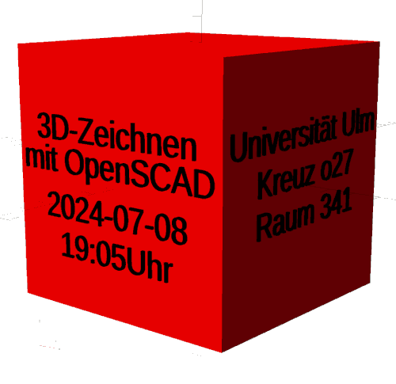](titelfolie.png)

Examples:

- Chess pieces

  [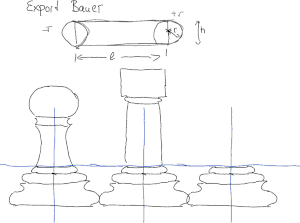](schach1.png)
  [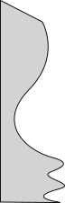](bauer.svg)
  [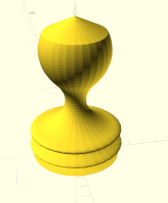](bauer.png)
  [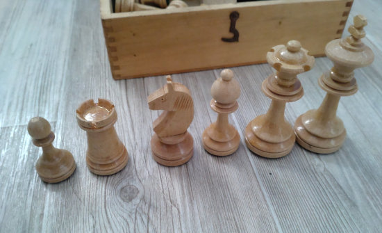](schach2.jpg)
- Spiral pasta

  [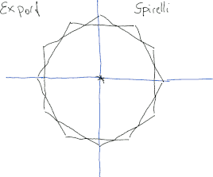](spirelli1.png)
  [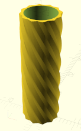](spirelli.png)
  [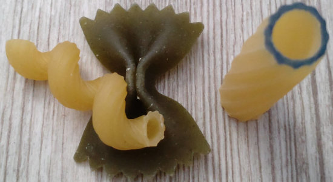](spirelli2.jpg)
- Steam locomotive

  [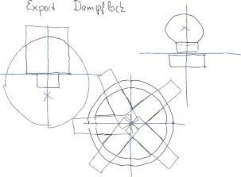](dampflok1.png)
  [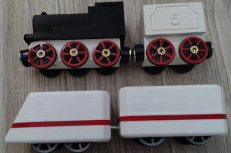](dampflok2.jpg)
- Water bottle rocket fin

  [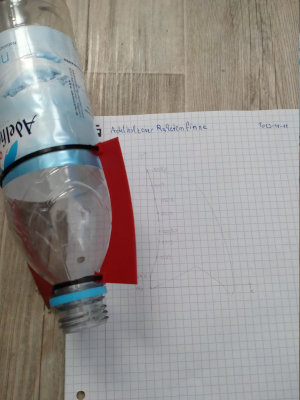](raketenfinne.jpg)
