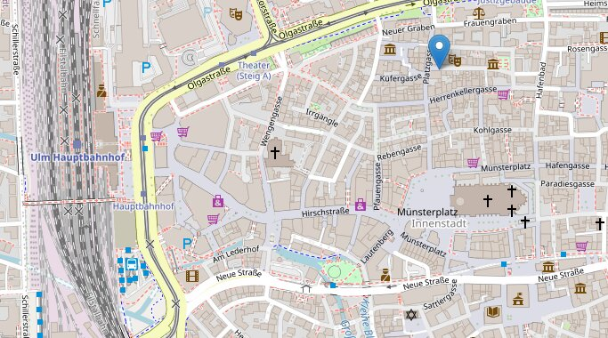
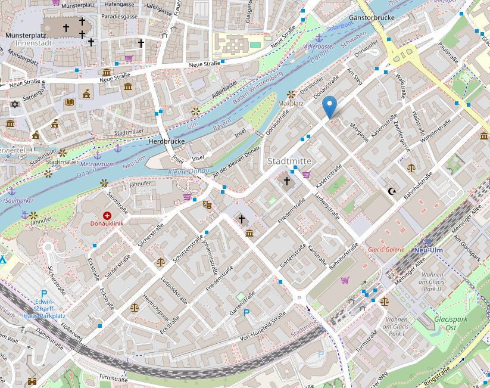
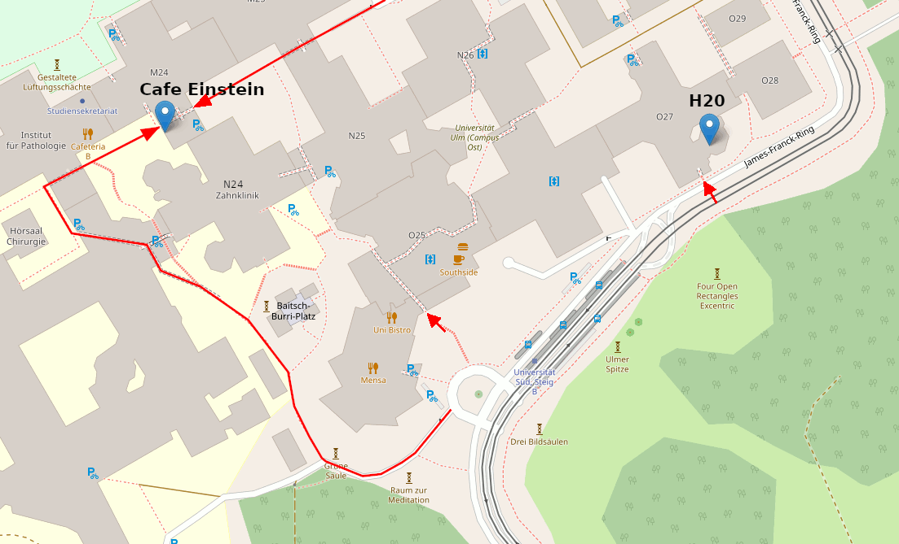

+++
title = "Contact"
date = ""
menu = "main"
weight = 6
hide_readingtime = true
+++
The best way to get in touch is simply to drop by:

  * Thursdays from 8 pm at the open meetup.  
    (It is best to check the Matrix channel beforehand to see whether anyone will be there.)
  * Mondays from 8 pm at the CCC Ulm meetup.

  * **Mastodon**: [@ccculm@chaos.social](https://chaos.social/@ccculm)
  * **Matrix**: [#freiraum](https://element.matrix4ulm.de/#/room/#freiraum:server.matrix4ulm.de)
  * **Email**: Send a message to: vorstand (_at_) lists.hackerspace-ulm.de  
  * **Github**: [frrm](https://github.com/frrm)
  * **Phone**: +49 731 / 2806434

<!--
  * **Join the mailing list:** <http://lists.hackerspace-ulm.de/listinfo/info>
  * **Wiki**: [dokuwiki](https://dokuwiki.ulm.ccc.de/)
-->

## Freiraum

  * Address: Platzgasse 18, Ulm, c/o FreeFM, Büchsenstadl, top doorbell (Freiraum)
  * [Directions from free FM](http://www.freefm.de/kontakt/anfahrt)
  * Map: [OpenStreetMap](https://www.openstreetmap.org/?mlat=48.40060&mlon=9.99131#map=14/48.40060/9.99131)

(&copy; [OpenStreetMap](https://openstreetmap.org/copyright))

<!--
## Temporärhaus Neu-Ulm

  * Address: Augsburger Straße 23-25, 89231 Neu-Ulm  
    (together with the [Haus der Nachhaltigkeit](https://www.h-d-n.org/))
  * Website: https://temporaerhaus.de/
  * Maps: [OpenStreetMap](https://www.openstreetmap.org/?mlat=48.396315&mlon=10.001978#map=14/48.396315/10.001978), [Google-Maps](https://maps.app.goo.gl/CEKmMcsT5TMs4HVX9)

(&copy; [OpenStreetMap](https://openstreetmap.org/copyright))
-->

<!--
## University of Ulm

(Map data by &copy; [OpenStreetMap](https://openstreetmap.org/copyright))

- **Room 341:** in building O27, 3rd floor (map: near H20, one floor up)
  [OpenStreetMap 341](http://www.openstreetmap.org/?mlat=48.42277&mlon=9.95750#map=18/48.42277/9.95750)
- **Lecture hall H20:** in building O27, 2nd floor  
  [OpenStreetMap H20](http://www.openstreetmap.org/?mlat=48.42277&mlon=9.95750#map=18/48.42277/9.95750)
- **Cafe Einstein:** Room M24/242, in the passage from N24 to M24  
  [OpenStreetMap Cafe Einstein](http://www.openstreetmap.org/?mlat=48.42283&mlon=9.95392#map=18/48.42283/9.95392)

Entrances:

- South entrance (the middle red arrow on the map)
- Entrance at O27 (the right-hand red arrow on the map)
- Entrance directly at Cafe Einstein (red arrows at the top)
- **Important: After 8 pm, the university entrances are usually locked, and the doors can only be opened with a student card.
  If you find yourself outside a locked door:**
  - **Cafe Einstein**: call 0731 50 26012, or go outside to Cafe Einstein (see map) and knock on the window
  - **H20 / 341**: the best option is to contact us on the Matrix channel [#freiraum](https://element.matrix4ulm.de/#/room/#freiraum:server.matrix4ulm.de)

Getting here:

- By bike: bike racks are available, for example, by the "South entrance" or at the public transport stop
- By public transport: get off at "Universität Süd";  
  see also: https://www.uni-ulm.de/einrichtungen/kiz/weiteres/campus-navigation/anreise/anfahrt-oepnv/
- By car: see https://www.uni-ulm.de/einrichtungen/kiz/weiteres/campus-navigation/anreise/
-->
