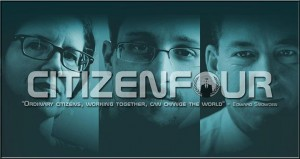

+++
author ="mwarning"
title = "Citizenfour public screening"
date = "2015-02-24"
categories = ["Announcements"]
hide_readingtime = true
+++
***Due to legal disagreements, the public screening has to be cancelled***

On Friday at 8 pm, Citizenfour will be shown at the Hackerspace Ulm premises. Everyone is welcome! It is also fine if someone wants to solder next door. :P

Citizenfour is a documentary by Laura Poitras about the American whistleblower Edward Snowden.

A must-see for anyone interested in the NSA surveillance scandal and freedom in the digital age.

Citizenfour / Friday / February 27, 2015 / 8 pm / Hackerspace-Ulm

(image by [Mr.w00t](https://www.flickr.com/photos/34053642@N05/))
