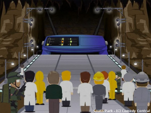

+++
author ="mwarning"
title = "“The OpenWrt System or There and Back Again”"
date = "2015-03-18"
categories = ["Announcements"]
hide_readingtime = true
+++
[OpenWrt](http://openwrt.org) is a Linux distribution for ordinary Wi-Fi routers, which are now found in almost every home. With OpenWrt, you can host websites on a router, connect USB cameras or storage sticks, and do almost any other interesting things familiar from Linux systems.

Next **Friday**, March 27, 2015, at **7 pm**, there will be a short introduction to OpenWrt. We will start by choosing a suitable image and flashing a router, then show how to find your way around the device, make common settings, and restore the original image if you no longer want to use OpenWrt. At the end, we may also show how to build an image yourself.

If you have never used OpenWrt but are not completely unfamiliar with Linux, this introduction is just right for you. It will probably last no more than 30 minutes, leaving plenty of time for questions and a relaxed discussion.

Everyone is welcome! :-)

Here is the [WRT54G](https://de.wikipedia.org/wiki/Linksys_WRT54G) — namesake of the OpenWrt project — in its role as the “Internet” in the television series “South Park” ;-)
