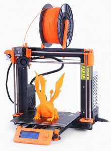

+++
author ="Jani"
title = "3D printing basics"
date = "2016-12-04"
categories = ["Announcements"]
hide_readingtime = true
+++
Before Christmas, a 3D printer is sure to be on some people's wish lists. 3D printing makes it possible to bring your own ideas to life. Work that once required a lot of tools to shape materials such as wood and aluminum can now be produced by 3D printing with almost no finishing work. It is useful to learn in advance how 3D printing works, what equipment is needed, and what to look out for. At first, you can download many models from the internet, prepare them for the printer, and print them. But it becomes really fun when you can create your own 3D print templates with CAD programs. Once you have seen how an idea is turned into a 3D model in a program and then made on a printer, you have a good starting point for your own 3D printer project.

Contents:  
1\. 3D printing basics  
2\. Creating 3D models  
3\. Preparing the 3D model for printing (slicing)  
4\. Printing the model  
5\. Tips for buying a 3D printer

Presented by:  
Peter Foschum and Jani Leinonen from Hackerspace Ulm e.V.

The talk will take place on Thursday, December 8 at 7 pm at [Freiraum (Hackerspace Ulm)](/contact).

