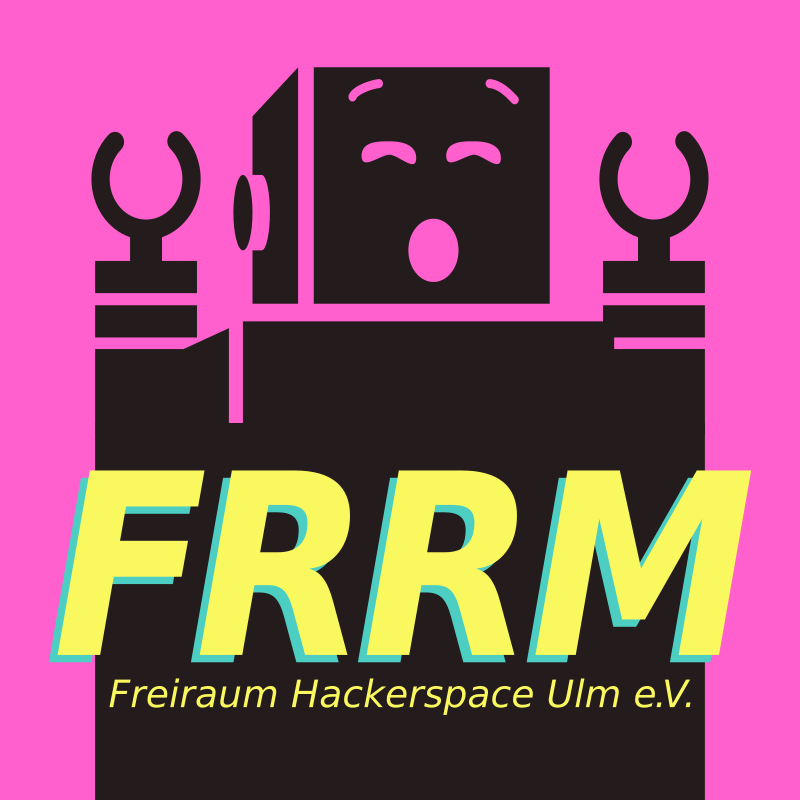
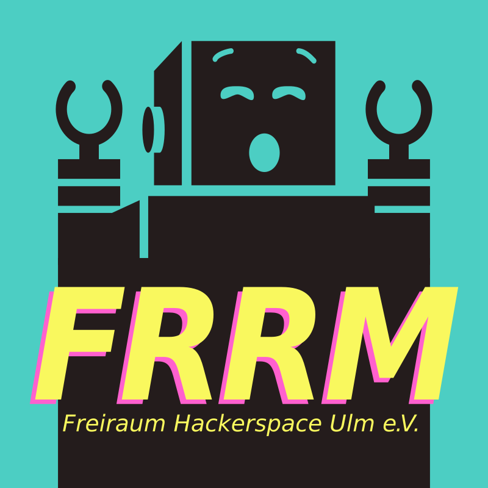
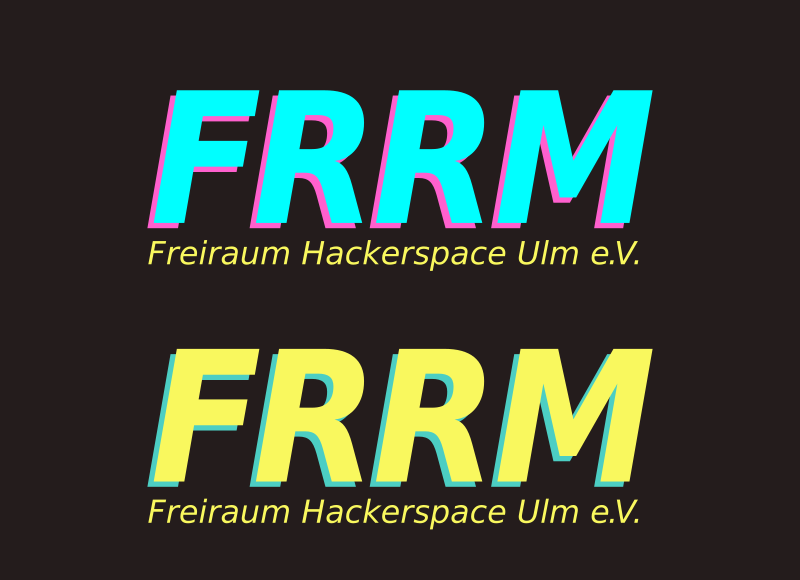

+++
author ="frdnd"
title = "Logo and stickers"
date = "2017-03-25"
categories = ["Projects"]
hide_readingtime = true
+++
We made ourselves a new logo (robot graphic by [the noun project](https://thenounproject.com/)); the old one was stolen anyway. As befits a good hackerspace, we immediately printed stickers too. There are 250 robot stickers and 1,000 with just the text. You are sure to spot some around Ulm.

The color scheme takes its cues from the 1980s and 1990s — I just realized we are not that far from vaporwave. Any suggestions?

