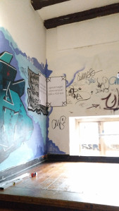
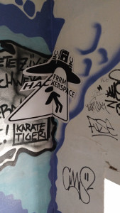
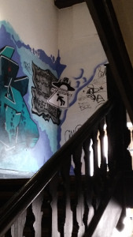

+++
author ="frdnd"
title = "Forced perspective"
date = "2017-04-13"
categories = ["Projects"]
hide_readingtime = true
+++
Alongside the graffiti in the Büchsenstadl stairwell, you can now find a Freiraum motif. The reference point is the first step of the staircase: from this viewpoint, the image looks correct in perspective.

Forced-perspective images can be made either by [projecting them with a projector](http://criticaltinkerer.blogspot.de/2014/08/forced-perspective-projector-wall-art.html) or by [photographing a target pattern and then distorting the image](http://www.instructables.com/id/Wall-Illusion-Easy-Forced-Perspective-Wall-Art-/). We used the second method here: the motif was created in Inkscape and then distorted accordingly. The Inkscape [multi-bool-extension](https://github.com/Moini/inkscape-extensions-multi-bool/blob/master/multipledifference.py) was helpful.

