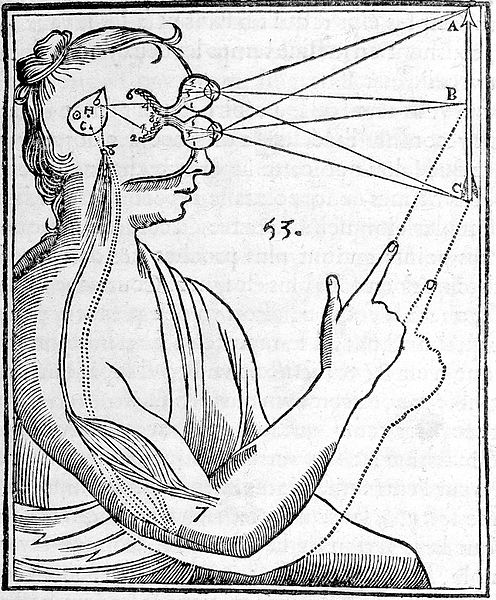

+++
author = "frdnd"
title = "Consciousness lightning talk"
date = "2018-03-15"
categories = ["Log"]
hide_readingtime = true
+++

In two weeks, on Thursday (29 March), Ferdinand will talk about consciousness/human consciousness. The talk is based on books by Susan Blackmore and Daniel Dennett, as well as the internet.

The slides are available [here (in English)](https://rwxrwx.de/talks/lt_consciousness.html).

