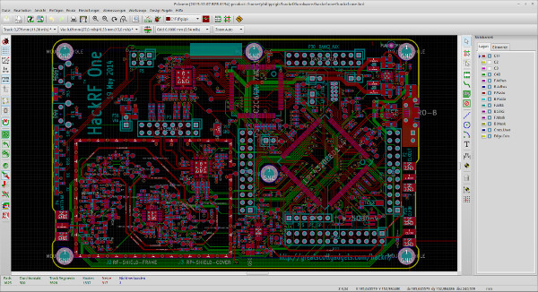

+++
author = "frdnd"
title = "PCB layout lightning talk"
date = "2018-04-10"
categories = ["Log"]
hide_readingtime = true
+++

Following his last talk about reverse engineering, Jani will speak on Thursday 12 April about PCB layout with KiCad.

You can find the reverse-engineering slides [here](ReverseEngineering.pdf).
