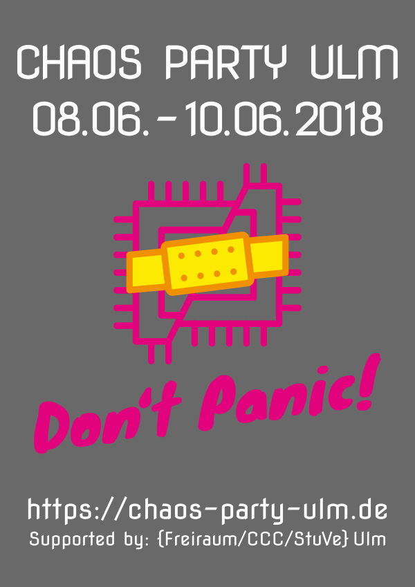

+++
author = "frdnd"
title = "#CPU18"
date = "2018-05-10"
categories = ["Log"]
hide_readingtime = true
+++
The first Chaosparty Ulm will take place in the cafeteria at the University of Ulm from 8–10 June 2018. It is a smaller Chaos event where many people interested in technology from across Germany (and beyond) will come together to spend a weekend immersed in projects and exchanging ideas on all kinds of topics.

There will be talks and workshops, mainly on hardware topics, and food will be available throughout. You can find more information about the event on our website [https://chaos-party-ulm.de]. If you have questions, you can email us at (kontakt@chaos-party-ulm.de)[mailto:kontakt@chaos-party-ulm.de] or reach us on hackint in #cpu. We look forward to seeing you!

