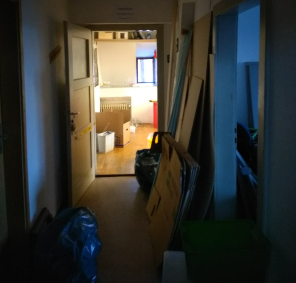
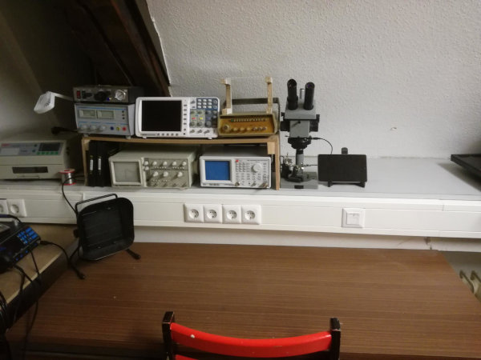
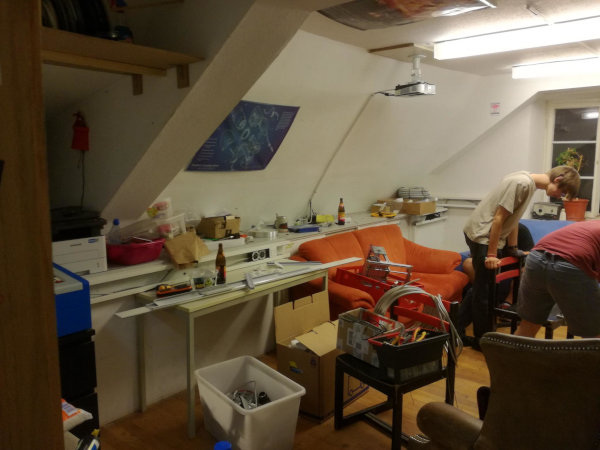
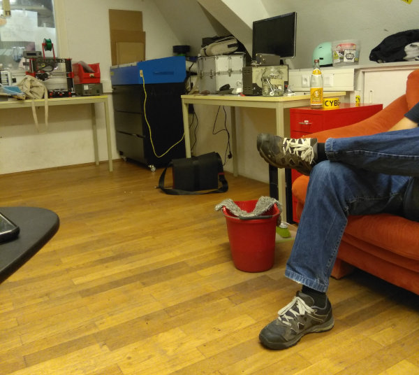

+++
author = "frdnd"
title = "Freiraum renovation"
date = "2018-08-09"
categories = ["Log"]
hide_readingtime = true
+++
After the worrying number of power strips we have daisy-chained over the past few years, it is time to install cable trunking along the walls. Simon dubbed the project “our Stuttgart 21”; the renovation will probably continue into next week.

Last month we also held an annual general meeting, where we decided to organize *CPU19*. There was a brief discussion about the name “Chaos Party Ulm”, because someone pointed out that a party does not last three days. That led to the new name — Chabos Pushen Upstream. As reported in the latest Datenschleuder, the CCC Ulm Erfa and Freiraum Hackerspace e.V. have merged. More on that later.

**Update**

The workshop is now fully equipped, with cable trunking for Ethernet, power, and compressed air.

Our main room is still _under construction_; we hope everything will be finished by the end of September. Until then, the open Thursdays continue, and anyone who wants to help is welcome to drop by.

**Update 2**

Yeah, it has been mopped; now we just need to put everything back.
