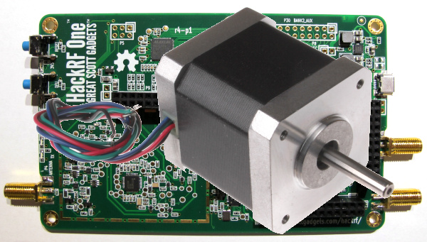

+++
author = "frdnd"
title = "Talks, etc."
date = "2018-09-13"
categories = ["Log"]
hide_readingtime = true
+++

Before the renovation and CPU18, we regularly held talks on the last Thursday of the month. So here is an announcement: Peter will speak about stepper motors on 25 October, and Jani will talk about SDR on 29 November. We plan to include a small hands-on session in the SDR talk (radio-controlled sockets, car keys, etc.).
