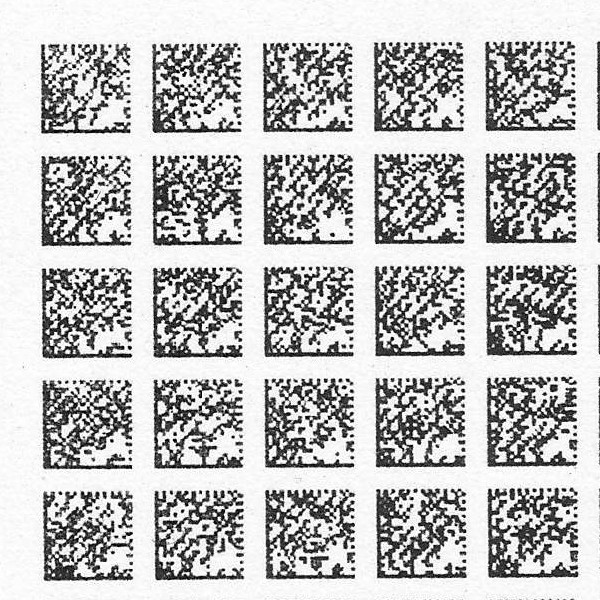

+++
author = "frdnd"
title = "Chaos Seminar 18/12"
date = "2018-12-05"
categories = ["Log"]
hide_readingtime = true
+++

At CCC Ulm, there will be a talk next Monday, 10 December at 8 pm, about paper as a data carrier — or how many megabytes fit on a piece of paper?

Here is some more information: [Chaos Seminar: Paper as a Data Carrier](https://ulm.ccc.de/ChaosSeminar/2018/12_Papier_als_Datentraeger)

**Attention: The talk takes place at the University of Ulm in H20 (building O27, level 2/ground floor).**
