+++
author = "frdnd"
title = "2018 in review"
date = "2018-12-06"
categories = ["Log"]
hide_readingtime = true
+++

When new people drop by Freiraum, there comes a point when we explain what we actually do here. Our main project is the infrastructure at Freiraum — or reducing entropy at Freiraum. Each member also has one project or another. Here are a few of the projects completed over the past year.

**Offgrid box (tdotu)**

This project is a somewhat oversized battery pack that supplies power to an organic shop/farmer out in the field. It uses used pedelec batteries, providing 1.2 kWh of capacity at 1 kW of power.

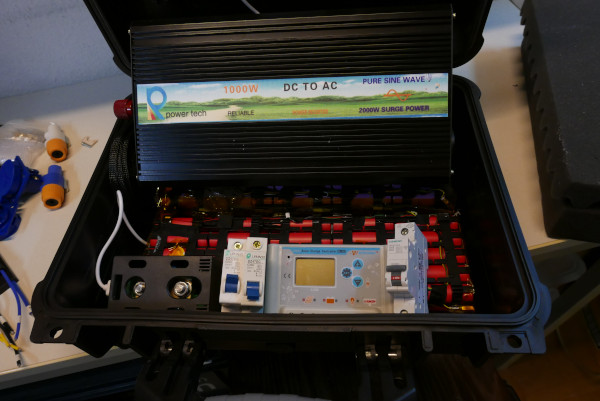
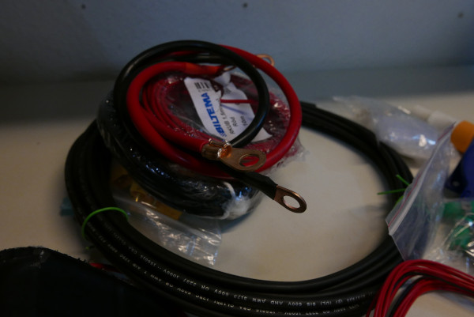
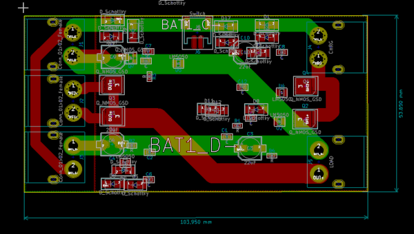

Offgrid box with a custom reverse-current protection board.

**FPGA board (tdotu)**

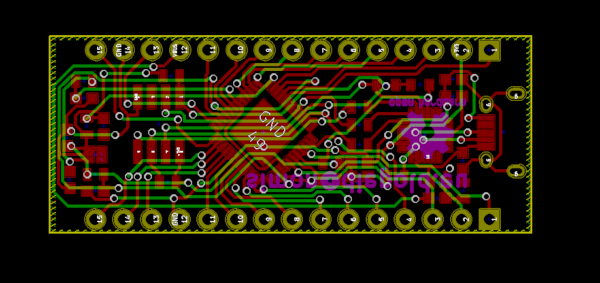

**K40 modifications and engraver (Georg)**

The K40 is being continuously upgraded; in 2018, an adjustable cutting bed was added. Georg is currently building a laser engraver, and we hope to hold a workshop on making one yourself.

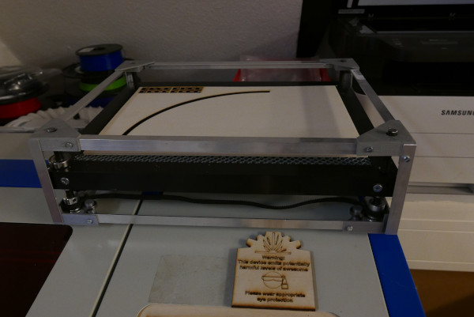

Cutting bed

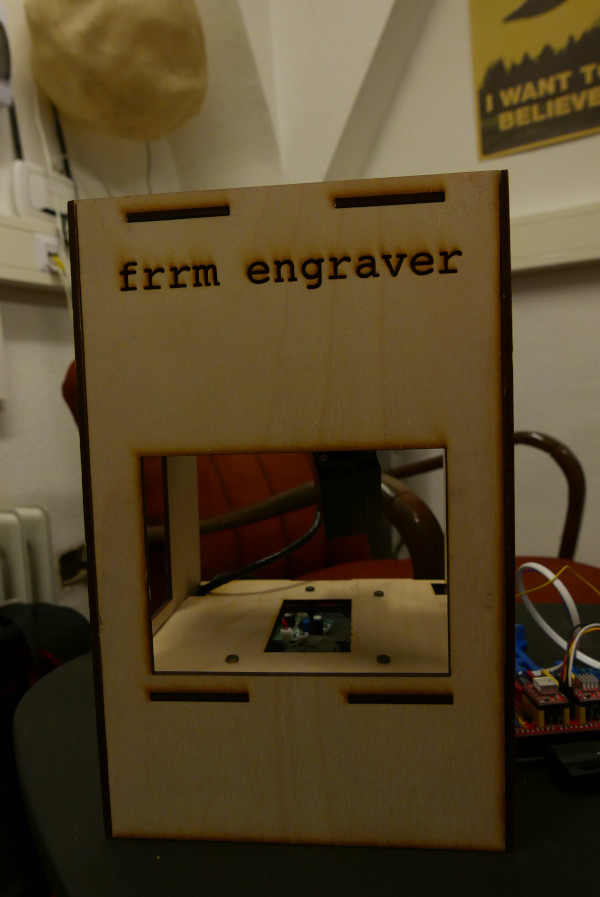

Engraver

**Jarvis (jay_pee_)**

Since jay-pee knows a thing or two about microphone arrays, we now have a Jarvis up and running too.

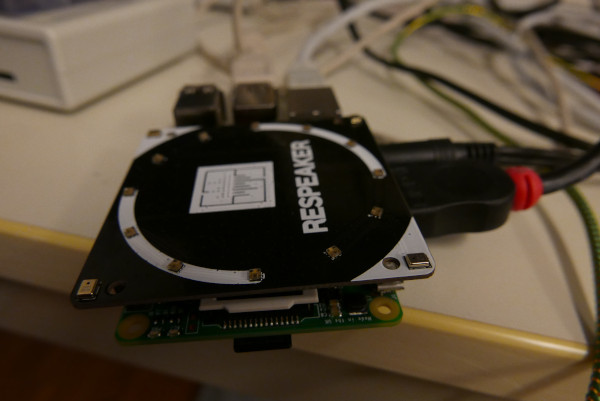

Raspberry Pi with ReSpeaker

**Reverse engineering (Jani)**

Jani reverse-engineered various things; some of them are allowed to be shown here.

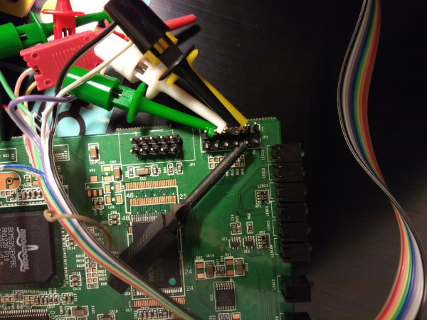

Wi-Fi base station

**Little things (frdnd)**

These are smaller projects, such as stamps for #CPU18, an NFC stick (via NODE), or a foray into the world of graphs.

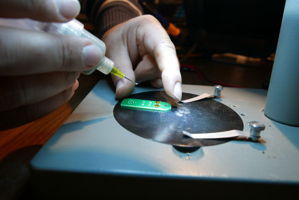
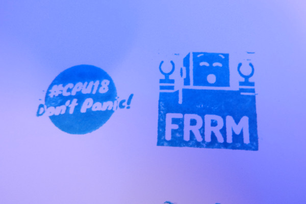
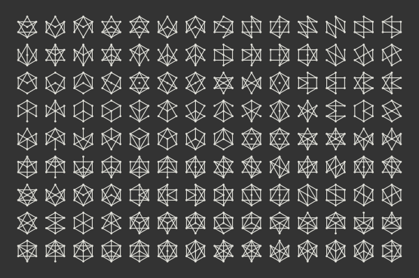

**Freiraum refurbishment**

Here is an overview of the recent changes at Freiraum.

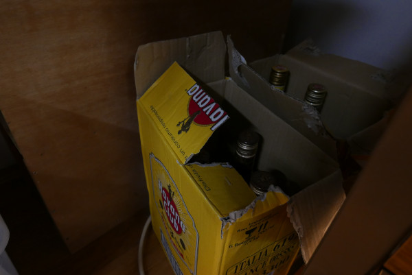

Leftovers from #CPU18

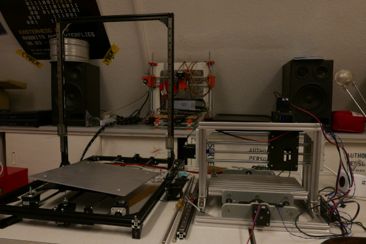

Milling machine and (new) 3D printer

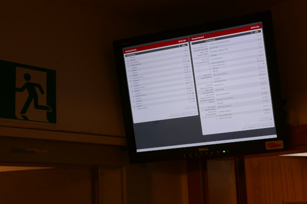

Dashboard with public transport connections

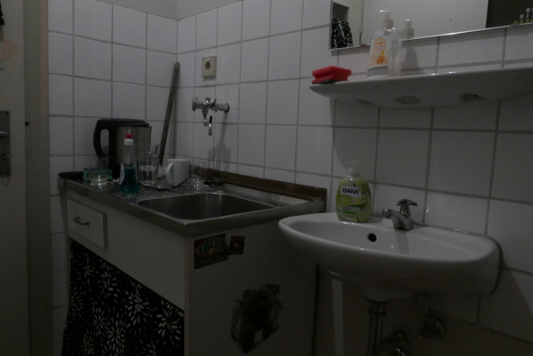

Renovated kitchen

**There were also several talks during the open Thursdays and group meetups by DARC (amateur radio), Freifunk, OSM, and CCC Ulm. Thanks to all our members and friends for their commitment :)**
