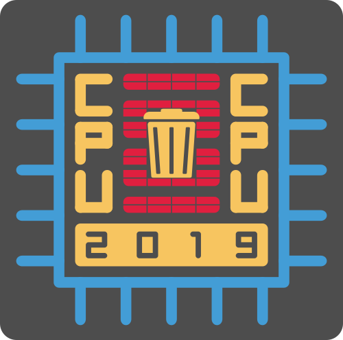

+++
author = "frdnd"
title = "Chaos Party Ulm"
date = "2019-06-17"
categories = ["Log"]
hide_readingtime = true
+++

As announced on Twitter, on posters, and by word of mouth, [#CPU-19](https://www.chaos-party-ulm.de/) is happening this weekend. You are all very welcome. CPU starts Friday, 21 June at 7 pm and ends Sunday, 23 June at 2 pm.

If you decide at short notice, you can also just drop by (admission: Friday €5 / Saturday €15 / Sunday €8).

Unfortunately, the #CPU website is not exactly overflowing with information, and what is there is well hidden. Here is the link to the [talks](https://pretalx.chaos-party-ulm.de/cpu19/schedule/).

  
