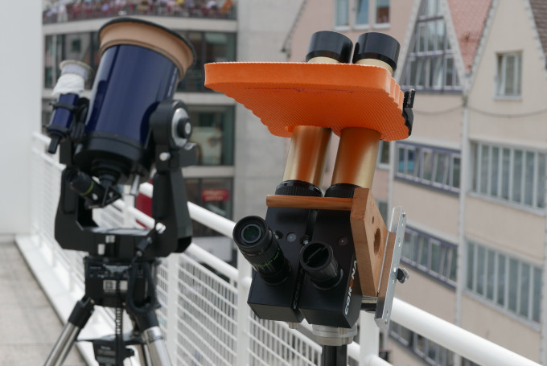
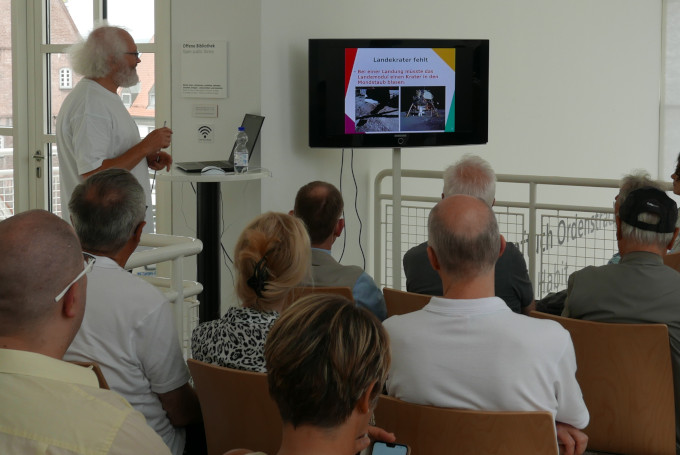
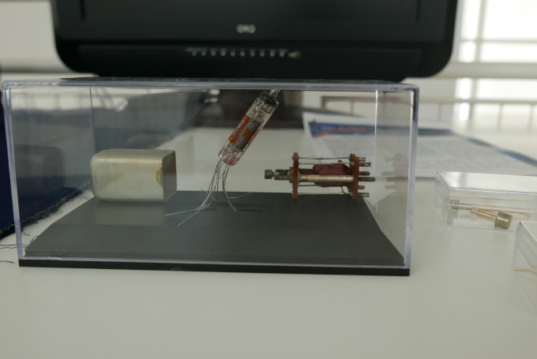

+++
author = "frdnd"
title = "50 years of Moon landing"
date = "2019-07-20"
categories = ["Log"]
hide_readingtime = true
+++

Through Peter, we have an overlap with the [Ulm Astronomical Working Group](http://aau.telebus.de/aau/default.php), which held talks today at the Stadthaus about the Moon landing and the conspiracy theories surrounding it. There were also several solar telescopes and background information on the history of spaceflight technology.

There are also two talks about it on media.ccc.de: [The Ultimate Apollo Guidance Computer Talk](https://media.ccc.de/v/34c3-9064-the_ultimate_apollo_guidance_computer_talk) and [How to fly to the Moon](https://media.ccc.de/v/gpn17-8605-how_to_fly_to_the_moon).

  

  
