+++
author = "frdnd"
title = "CERN open days"
date = "2019-09-19"
categories = ["Log"]
hide_readingtime = true
+++

The Open Days took place on Saturday and Sunday, 14–15 September 2019. We set off on Friday evening at around 5:30 pm and arrived in Prévessin-Moëns at about 11:30 pm. The town lies inside the accelerator ring on the French side, where we found an inexpensive hotel.

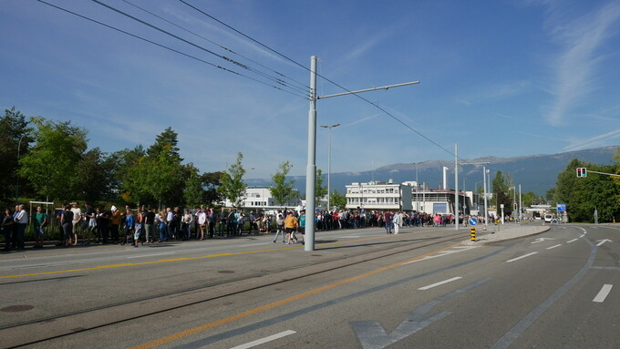

There was already a long line at the entrance when we arrived, but everything was very relaxed and the visitors were in good spirits. After about 20 minutes, we were able to enter the site.

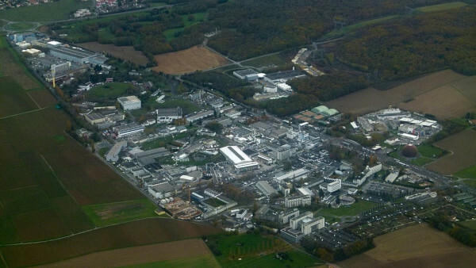

The site is really large, and there was something to see in almost every building.

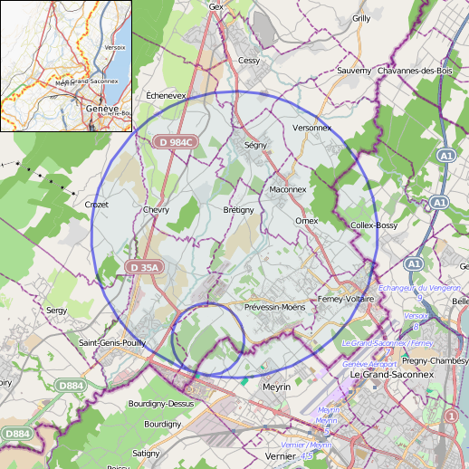

Here you can see the accelerator ring of the LHC experiment — Meyrin is visible at the bottom. The ring that houses the [LHC](https://de.wikipedia.org/wiki/Large_Hadron_Collider) is 26.7 km long and 3.8 metres wide. It was built in the 1980s for the LEP experiment and lies 50–175 metres underground. The LHC experiment has been running there since 2008.

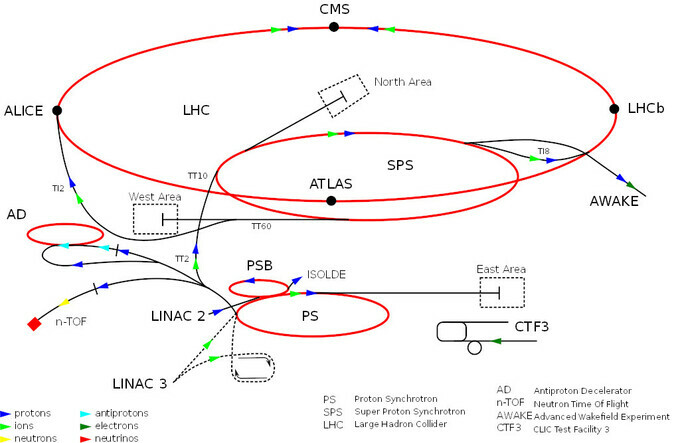

The first accelerator at CERN went into operation in 1957. The CERN complex now consists of many different parts: accelerators for protons, ions, antiprotons, and so on.

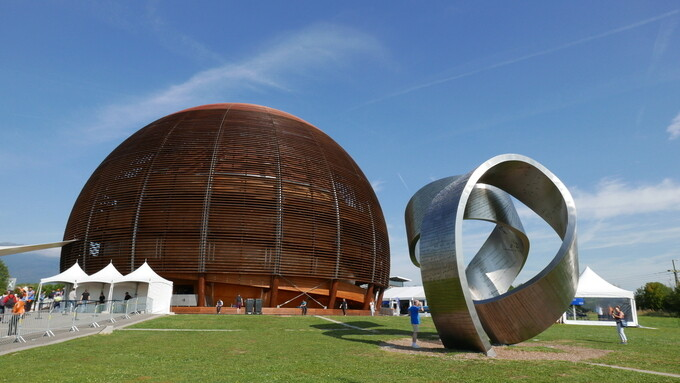

This is the entrance area towards ATLAS; the sculpture shows formulae and researchers from all over the world. On Saturday there were waits of up to three hours, because everyone wanted to visit the ATLAS workshop or the accelerator ring. We skipped that and went on one of the many tours instead.

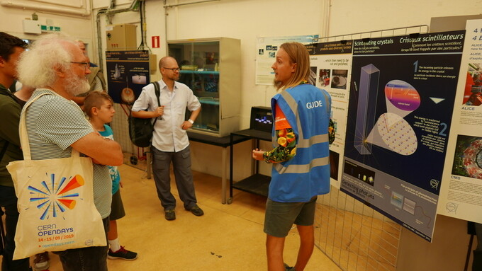

Our first stop was the “Crystal laboratory”, where Nikolaus showed us how various [scintillator crystals](https://de.wikipedia.org/wiki/Szintillator) glow and how they are used in the [CMS](https://de.wikipedia.org/wiki/Compact_Muon_Solenoid) detector.

Nikolaus was one of the many CERN employees who volunteered to help and present their work, so you could ask him all sorts of questions. Time was the only limiting factor: 70,000 visitors came to the last Open Days, so the tours were tightly scheduled.

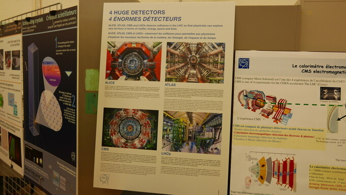
Unfortunately, we had not been able to reserve a place on the popular tours of the accelerator ring when registering. Nikolaus suggested that we go to CMS early on Sunday (on the other side of the accelerator ring) and register there in person.

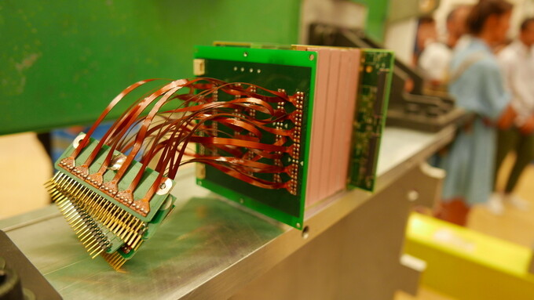

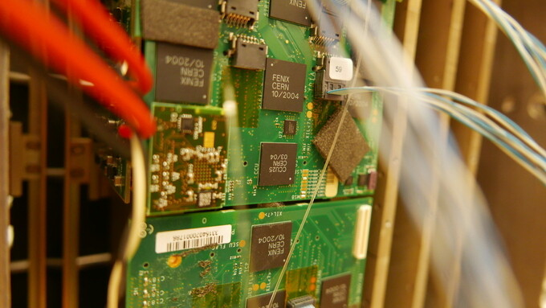

Some of the components used in CMS.

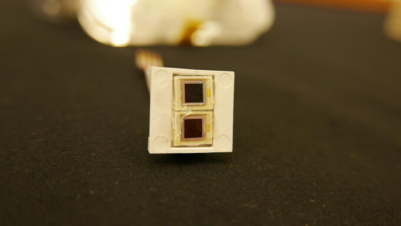

This is one of the scintillator crystals; they are effectively the individual pixels of the sensor.

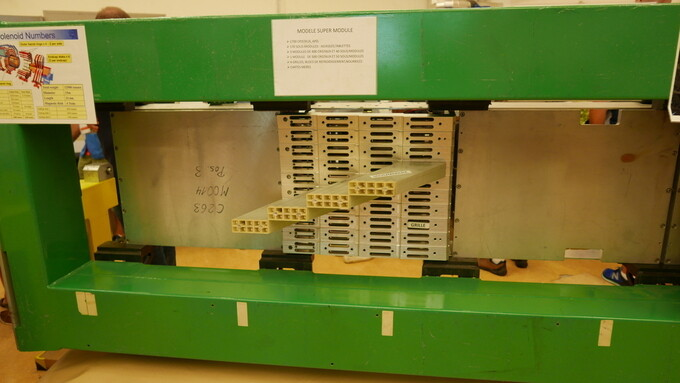

Several of these cells are arranged radially around the particle collision point to measure the trajectories of the resulting particles (protons, pions, or kaons). When a particle hits a crystal, it produces a flash of light, which is detected using photomultipliers.

Nikolaus's doctoral research focuses on increasing the readout speed to obtain better time-resolved measurements. One way to do this is to modify the crystal material by doping it.

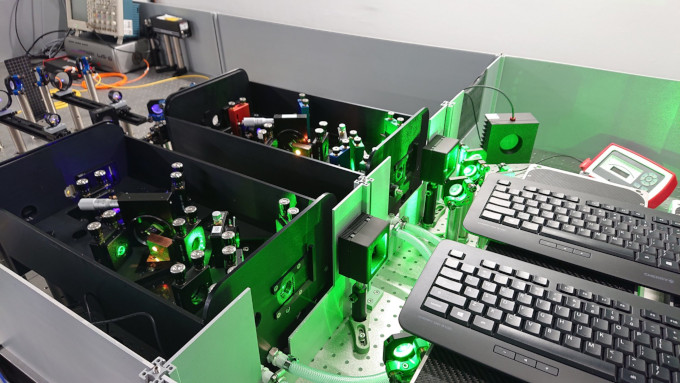

Our next stop was the MEDICIS facility. Its goal is to produce radioisotopes for medical applications (SPECT/PET scans, radiotherapy, radionuclide therapy). [Vadim](https://medicis-promed.web.cern.ch/vadim-gadelshin), a young staff member who was finishing his doctorate, showed us a laser-experiment setup used to separate the particles/isotopes produced in collisions.

Particles can be separated by their mass-to-charge ratio. If isotopes are produced in a collision, they must be selectively ionized so they can be separated from other isotopes with the same mass. Lasers are used for this; Vadim had been working on tuning them optimally.

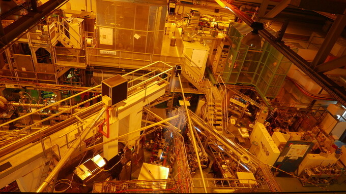

The image above shows the [ISOLDE](https://de.wikipedia.org/wiki/ISOLDE") experiment, which is used to produce such ion beams.

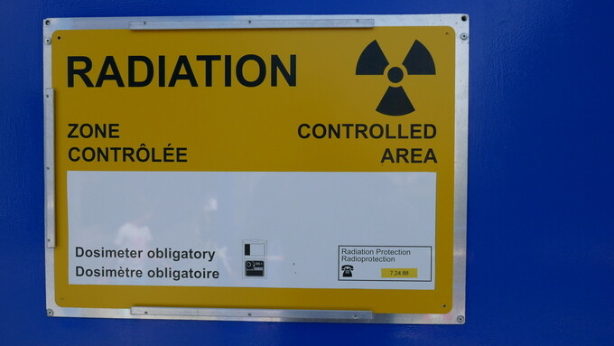

Warnings about radiation can be seen in the ISOLDE building and many other places. Scientists who are there during operation wear various kinds of dosimeters.

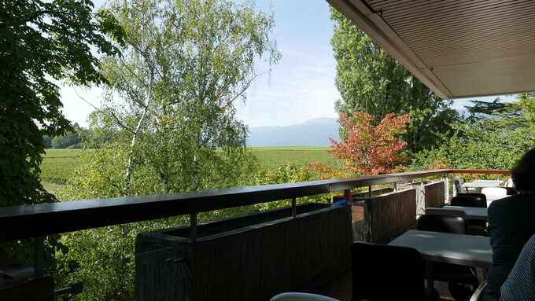

Lunch for €10 in CERN's staff restaurant; the food was delicious and the view was fantastic. (A beer on the promenade by Lake Geneva costs a mere €8.)

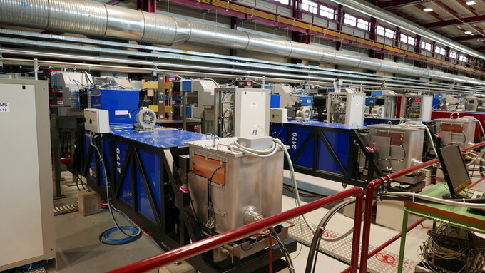

Our next stop was [LINAC 4](https://de.wikipedia.org/wiki/CERN_Hadron_Linacs#Linac_4), a linear accelerator that accelerates negative hydrogen ions. These form the basis for the proton beam used at ISOLDE.

At the back of the blue boxes (made by Thales), you can see the square waveguides that carry electromagnetic waves 12 metres underground. This is technology also used in radio masts and radar, only on a larger scale.

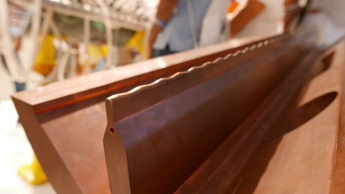

The electromagnetic waves travel through copper conductors, whose alternating field accelerates the hydrogen ions. The ridges are precisely tuned to the hydrogen ion being accelerated; the waveform changes along the length of the component.

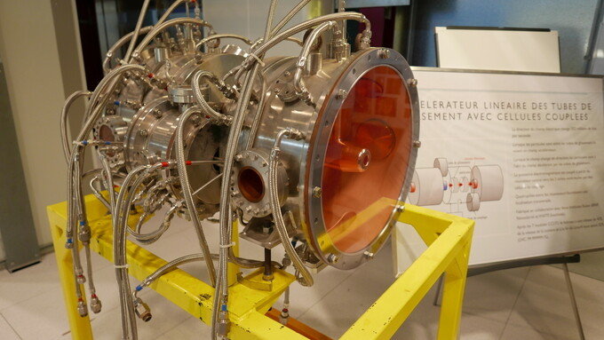   

Everything takes place in a high vacuum.

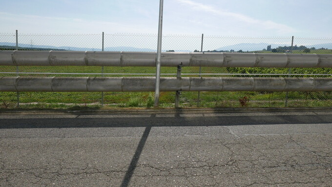

The above-ground part of the LHC ... no, those are just heating pipes ;)

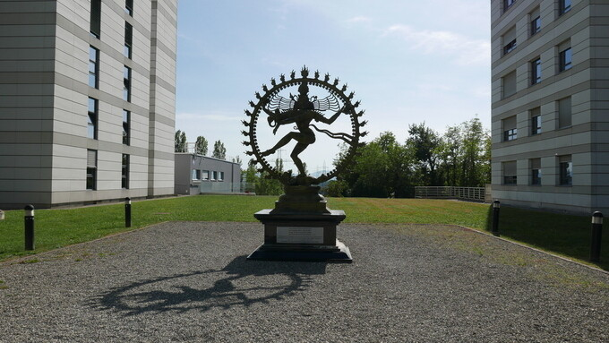

CERN has visiting researchers from 85 different countries. This statue was donated by the Indian Atomic Energy Commission.

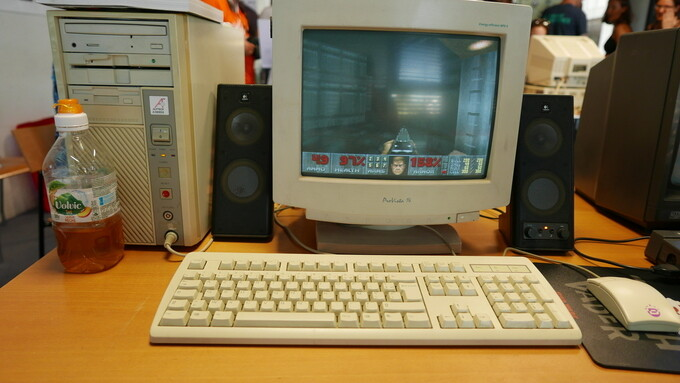

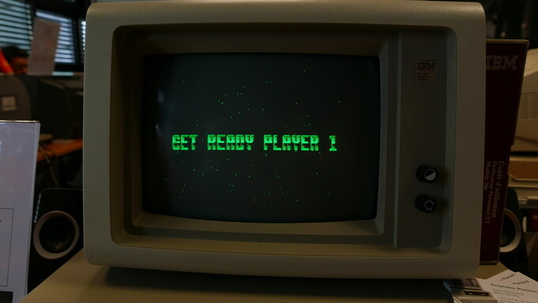

There was also a station with retro games on old computers. Overall, everything was very well organized, and there were even live bands made up of alumni.

CERN closed at 7 pm, so we still had time to see Geneva.

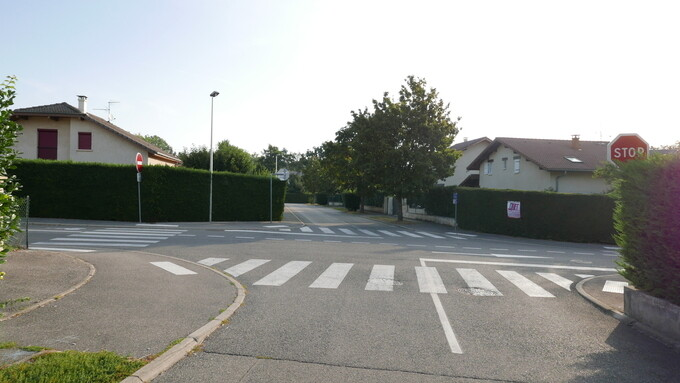

The next day we drove to [Cessy](https://en.wikipedia.org/wiki/Cessy) in France to see the Compact Muon Solenoid (<a href="https://en.wikipedia.org/wiki/Compact_Muon_Solenoid">CMS</a>).

Cessy is a small town, with nothing to suggest that cutting-edge research is happening here. Tim Berners-Lee lived in Cessy when he “invented the internet”.
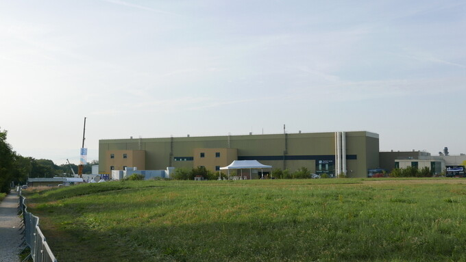

This is the surface hall for CMS. The detector is 100 metres underground, 21 metres long, and 15 metres in diameter.

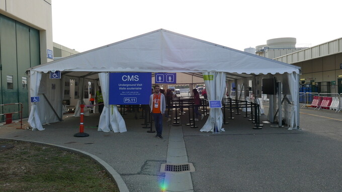

We arrived early enough to register for an underground tour without any trouble.

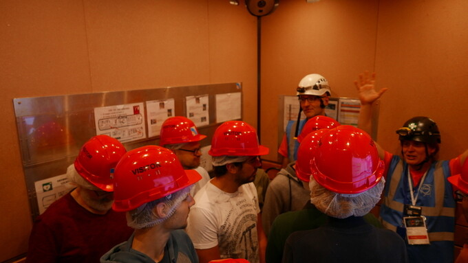

Our guide (dark helmet) was very enthusiastic and in a great mood.

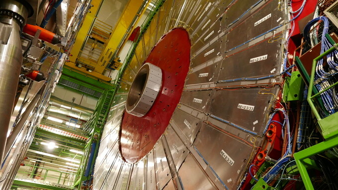

Since the LHC is shut down, upgrade and maintenance work can now be carried out. Here you can see the individual modules (later they are pushed together).

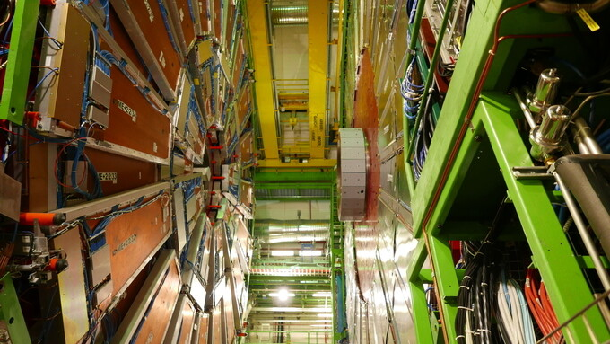

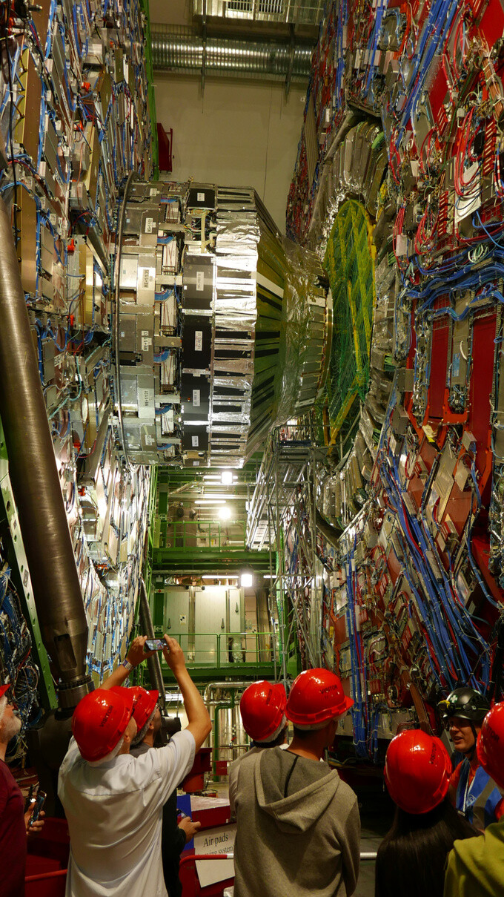

The scale is really impressive: the detector consists of 15 layers and weighs 14,000 tonnes in total.

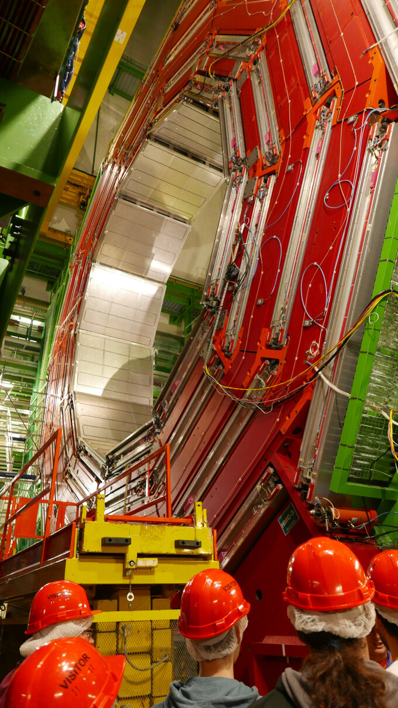

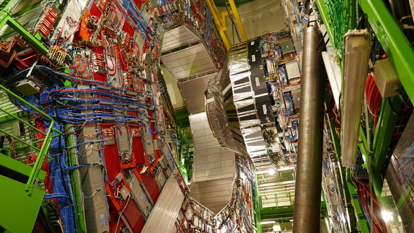

The magnet inside is 13 metres long and 6 metres in diameter. It is the strongest magnet built so far and operates at −268.5°C. The particles' speed at collision differs from the speed of light by only 3 m/s.

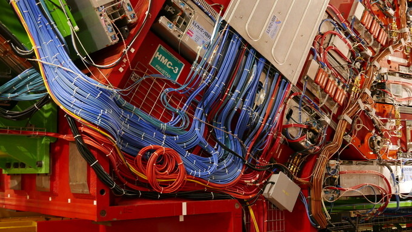

I wish I had cable management like this at home.

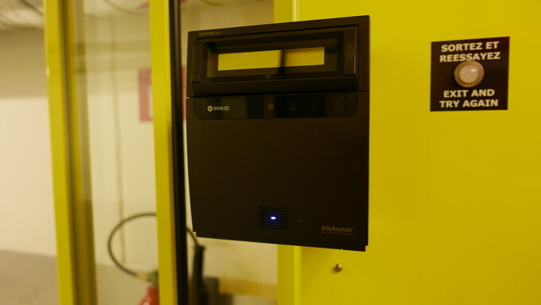

The access area has a high security level; here you can see an iris scanner.

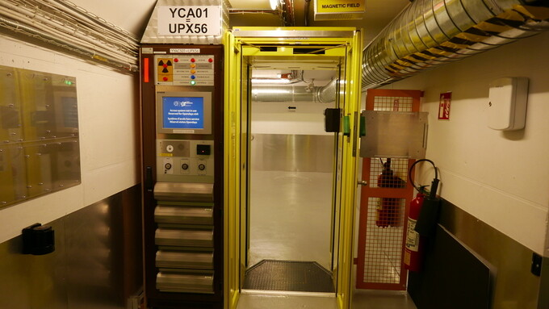

The system has a redundant locking system. Since radiation is also produced here, it must be ensured that the chamber is empty when it is operating.

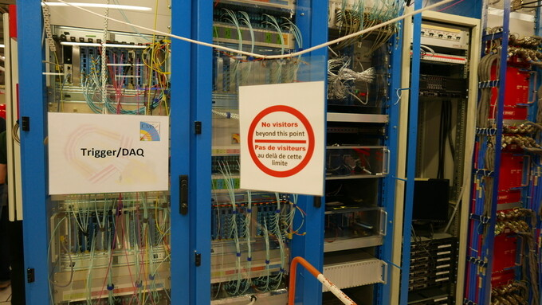

This is the trigger system. When the accelerator is running at full power, there are one trillion (10^12) proton-proton interactions per second. The trigger evaluates them and reduces them to 100 interesting events, which are then stored.

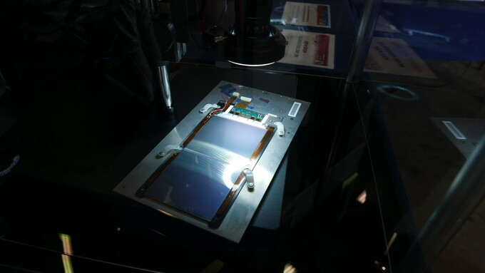

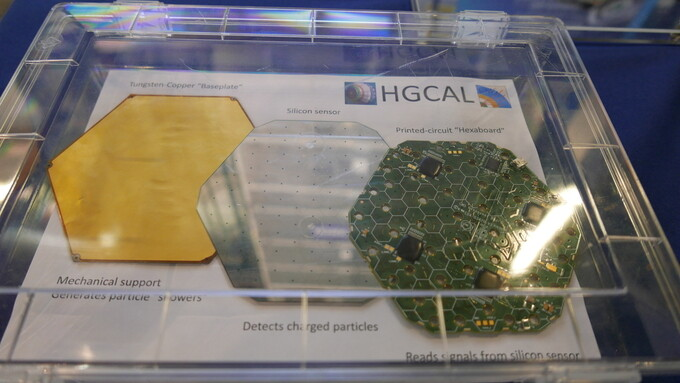

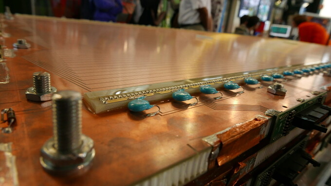

After the tour, we looked at the different sensors in more detail on the surface.

All in all, it was a great trip that everyone should take at least once.

Markus's tip: you can still register for some of the tours from January to March (no experiments during maintenance) and now during the “long shutdown”. [https://visit.cern/tours/guided-tours](https://visit.cern/tours/guided-tours).

**Update:** One or two factual inaccuracies in the MEDICIS section were corrected, and a picture of the laser setup was added — thanks, @Vadim!
