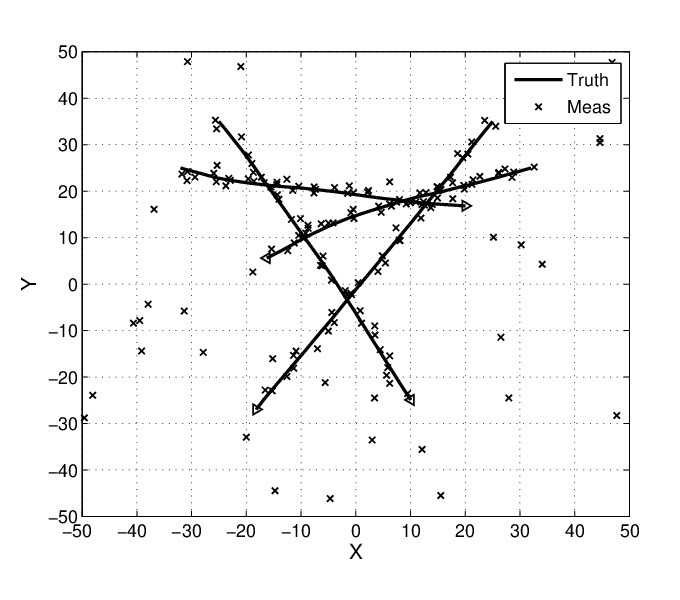

+++
author = "frdnd"
title = "Talk announcement"
date = "2020-01-30"
categories = ["Log"]
hide_readingtime = true
+++

Many of us have so many interesting things to talk about, but it often takes a lot of effort to give a talk. All the more reason to be happy that we have two talks coming up over the next few weeks.

**Forward-backward smoothing of object trajectories using random finite sets.**

Karotte/Lotta will talk about smoothing object trajectories on 6 February 2020 from 8 pm. She uses random finite sets for the smoothing; there is not yet an entry for them on Wikipedia, so here is an [abstract](https://ora.ox.ac.uk/objects/uuid:09211ed9-7cc1-4401-9ae9-a1ebc2a1f782):

*Multitarget tracking is the process of jointly determining the number of targets present and their states from noisy sets of measurements. The difficulty of the multitarget tracking problem is that the number of targets present can change as targets appear and disappear while the sets of measurements may contain false alarms and measurements of true targets may be missed. The theory of random finite sets was proposed as a systematic, Bayesian approach to solving the multitarget tracking problem. The conceptual solution is given by Bayes filtering for the probability distribution of the set of target states, conditioned on the sets of measurements received, known as the multitarget Bayes filter.*

This method can be used in the context of audio, RF, antenna arrays, or autonomous vehicles' environmental models.

**Confluence - introduction and how-to**

Petersilie/Jan will introduce [Confluence](https://en.wikipedia.org/wiki/Confluence_(software)), collaboration software by Atlassian, on 20 February 2020 from 8 pm.

Freifunk Ulm uses Confluence instead of a wiki (whether Confluence might itself be a wiki is something you should ask Jan), and it is free for non-profit organizations.
