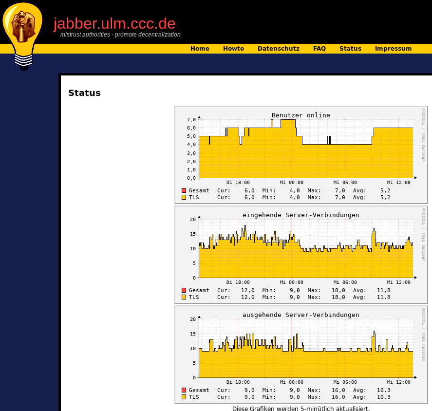

+++
author = "Marcus"
title = "Jabber server is back up"
date = "2020-07-01"
categories = ["Log"]
hide_readingtime = true
+++

Our Jabber server was down. Unfortunately, we messed up the `prosody` and `certbot` scripts, so `prosody` stopped speaking SSL after the SSL certificate was updated. We have fixed this now.

Our status page is working again too:
<https://jabber.ulm.ccc.de/status.html>

Have fun chatting!

