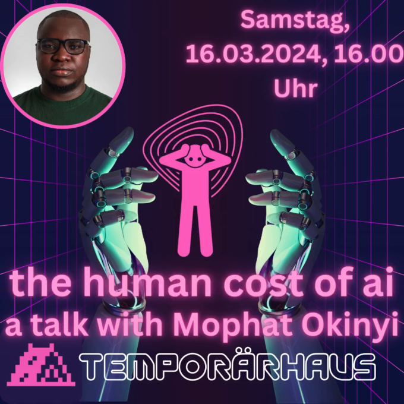

+++
author = "frdnd"
title = "Talk announcement"
date = "2024-03-11"
categories = ["Log"]
hide_readingtime = true
+++

Constanze kindly put us in touch with [Guido](https://icegorilla.com/). As part of the [cyberfestspiele](https://www.cyberfestspiele.net/), Guido connected us with Mophat Okinyi, an AI and human rights activist. AI is a topic close to our hearts, and technology cannot be considered independently of its social consequences, so we brought the talk to Ulm together with Temporärhaus.

The talk will take place on March 16, 2024 at 4 pm at Temporärhaus (Augsburger Str. 23, 89231 Neu-Ulm). We look forward to seeing many of you there!

[**YouTube livestream**](https://www.youtube.com/watch?v=YE5ZKZYNKp4)

[“The working conditions are appalling” interview, Netzpolitik 24/03/13](https://netzpolitik.org/2024/ki-arbeiter-in-kenia-die-arbeitsbedingungen-sind-erbaermlich/)

[Background article in The Guardian, 23/08/02](https://www.theguardian.com/technology/2023/aug/02/ai-chatbot-training-human-toll-content-moderator-meta-openai)

And here is the official press text (via Guido):

**Mophat Okinyi, Founder & CEO, Techworker Community Africa**

[Mophat Okinyi](https://www.linkedin.com/in/mophat-okinyi/) is a respected data trainer specializing in machine learning and AI. The [Responsible AI Institute](https://www.linkedin.com/company/responsible-ai-institute/) recognized him with the [RAISE 2023 Outstanding Individual Award](https://www.responsible.ai/post/responsible-ai-institute-hosts-annual-raise-event-charting-the-future-of-responsible-ai). Mophat Okinyi was honored for his inspiring leadership in responsible AI through research, advocacy, policy, and trustworthy frameworks.

As an AI and human rights activist, he is primarily committed to the fair treatment and rights of online content moderators, tech workers, and data training professionals. His main concern is ensuring these people are not relegated to the status of disposable backend workers in AI development. He is driven by the belief that every worker deserves to be treated with respect and dignity, and that their fundamental human rights must be upheld. To realize this vision, he advocates for an environment in which technological and AI progress benefits all of humanity without discrimination. By advocating fair treatment and protection of fundamental human rights, he aims to create a future in which technology benefits everyone, regardless of race or skin color.

As a committee member of the African Content Moderators Union, Mophat leads initiatives advocating the fair treatment of African tech professionals and content moderators. His work addresses challenges in working conditions and promotes professional development, reflecting his commitment to the rights and well-being of African tech professionals and content moderators.

At the same time, as Founder and CEO of Techworker Community Africa, Mophat works to create a thriving technology industry in Africa. The organization empowers, informs, and supports tech workers, ensuring that their rights are protected while fostering trust and enthusiasm for contributing to the growth of the digital economy.

In addition to these influential roles, Mophat has contributed to data generation for machine learning. He played a key role in providing data used to filter content considered illegal or harmful during ChatGPT's development. The [Alan Turing Institute](https://www.turing.ac.uk/?utm_source=AIUKmicrosite&utm_medium=button&utm_campaign=aiuk23) listed him as a speaker at [AI UK 2024](https://ai-uk.turing.ac.uk/), where he will discuss the critical intersection of data, work, and AI. His insightful contributions on this topic have also appeared in prominent global media such as the Wall Street Journal, Times Magazine, The Guardian, the BBC, and others.

Driven by his desire for fair technology policy in artificial intelligence, Mophat and three colleagues submitted [a petition to the Kenyan Parliament](https://twitter.com/MercyMutemi/status/1678984336996028416) to investigate the working conditions of tech workers in Kenya. This bold step underscores his commitment to positive change in the tech industry by advocating for the rights and well-being of tech professionals.

Through his advocacy, publications, and talks, Mophat continues to shape the vision of responsible AI and make an important contribution to the global dialogue on the ethical implications of AI development and use.

*This text was translated by machine.*
