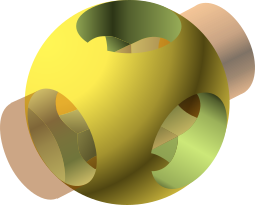

+++
author = "roland"
title = 'OpenSCAD talks'
date = "2024-07-05"
categories = ["Log"]
hide_readingtime = true
+++

OpenSCAD is free 3D CAD software often used to create 3D-printing models. However, it is useful even without 3D printing.

We are planning a series of three talks about OpenSCAD:

1. [2D basics, creating 3D models from 2D](/ccc/chaosseminar/2024_07_openscad1/) (Marcus)
2. 3D basics, automatically generating things such as threads and gears (Thomas)
3. Advanced concepts and libraries (Roland)

The [first talk](/ccc/chaosseminar/2024_07_openscad1/) will take place on Monday, July 8 at 7:05 pm at Ulm University (O27, 3rd floor, Room 341).

In principle, all our talks are open to the public (anyone interested in the topic is very welcome) and suitable for beginners.
For Part 3, however, you should either have attended an earlier part or already have some programming or OpenSCAD experience.

**About OpenSCAD:**

Unlike most 3D CAD systems, in OpenSCAD:
 - 3D objects are created with text rather than a mouse (in some ways, like programming languages). For example, you can create a sphere with ``sphere(5);``.
- Complex models are created primarily by adding, subtracting, and intersecting simple primitives.

This may seem a little unusual at first, but it makes it possible to create (or automatically generate) highly flexible, parameterizable, and clearly structured models in a simple, accessible way.

- OpenSCAD homepage: https://openscad.org/
- OpenSCAD syntax: https://openscad.org/cheatsheet/
