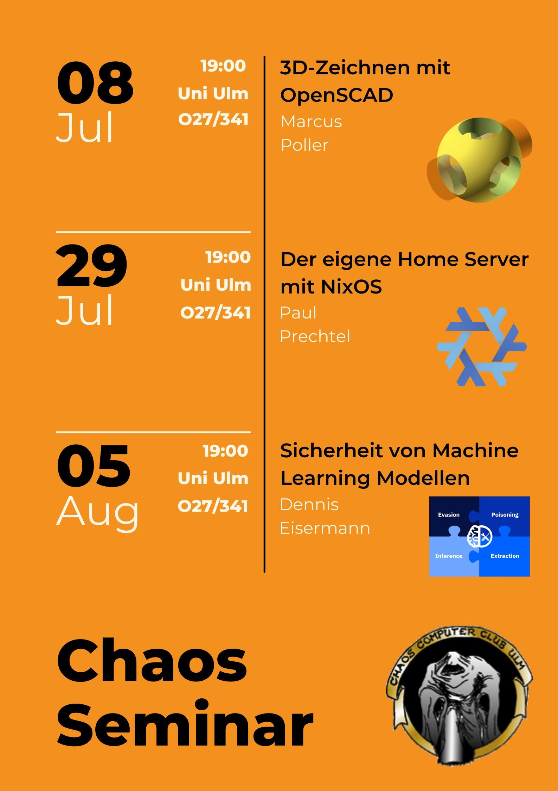

+++
author = "roland"
title = 'Upcoming Chaos Seminars'
date = "2024-07-07"
categories = ["Log"]
hide_readingtime = true
+++

The next Chaos Seminars are planned as follows:

- 2024-07-08 [3D drawing with OpenSCAD: 2D basics, creating 3D models from 2D](/ccc/chaosseminar/2024_07_openscad1/)  
  (see also the two other blog posts)
- 2024-07-29 [NixOS: Your own home server with NixOS](/ccc/chaosseminar/2024_07_nixos/)
- 2024-08-05 [Security of machine learning models](/ccc/chaosseminar/2024_08_machine-learning/)

As always, the talks are open to the public (anyone interested in the topic is very welcome).

Flyer (please feel free to share it):

