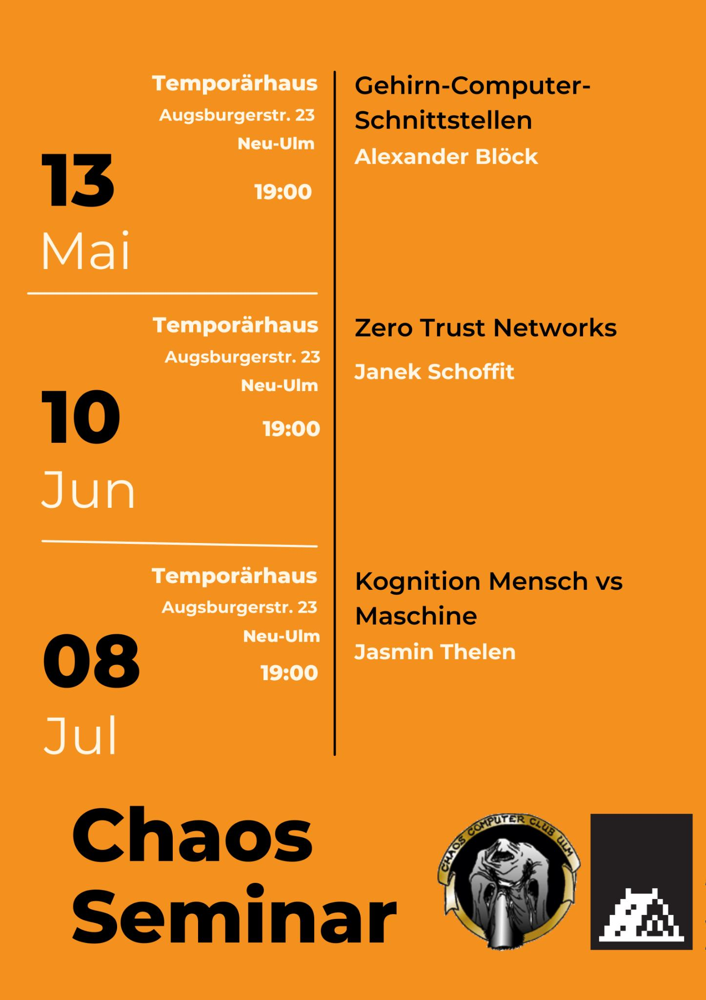

+++
author = "roland"
title = 'Chaos Seminars in May, June, and July'
date = "2025-05-05"
categories = ["Log"]
hide_readingtime = true
+++

The Chaos Seminars for May through July are planned:

- 2025-05-13 [Brain-computer interfaces](/ccc/chaosseminar/2025_05_brain_computer_interfaces/)
- 2025-06-10 [Zero Trust Networks](/ccc/chaosseminar/2025_06_zero_trust_networks/)
- Unfortunately cancelled: ~~2025-07-08~~ [Human cognition vs. machine cognition](/ccc/chaosseminar/2025_07_koginition_mensch_vs_maschine/)

The Chaos Seminars take place at [Temporärhaus Neu-Ulm](/contact/index.html#temporärhaus-neu-ulm).

As always, the talks are open to the public (anyone interested in the topic is very welcome).

Flyer (please feel free to share it):

